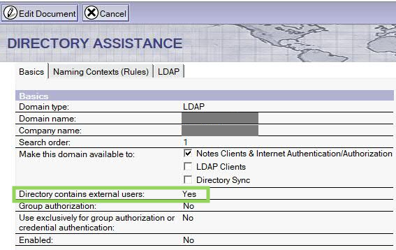
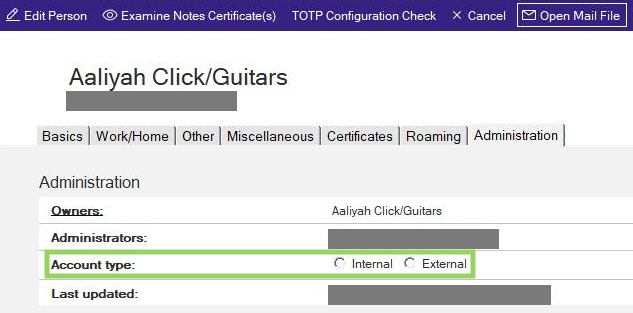

<h1>How CCB and CCX Licenses Are Calculated</h1>

<details close markdown="block">
  <summary>
    Table of contents
  </summary>
  {: .text-delta }
1. TOC
{:toc}
</details>

The two (2) strategic licenses for HCL Domino, are:

**Complete Collaboration Business Edition (CCB) -and-
Complete Collaboration eXternal user (CCX)**

### Complete Collaboration Business Edition (CCB)

CCB entitlements are needed for all of the employees and contractors in your enterprise needing access to your Domino CCB servers – covering all B2E (Business-to-Employees) scenarios. All CCB users have access to the full spectrum of Domino capabilities.

A server licensed under CCB also include unlimited external web user access as needed for most B2C (Business-to-Consumer/Citizen) scenarios:

* Guests: unlimited anonymous browser users can freely access your Domino based websites.
* Known Guests: unlimited registered users with credentials to login for read-only access to applications.

(see further here [“Licensing Update: Domino V12 and Key CCX Enhancement”](https://blog.hcltechsw.com/domino/licensing-update-domino-v12-and-key-ccx-enhancement/)).

The volume of entitlements needed for a CCB configuration is the count of all credentials in Domino directories or any other authentication source used by the enterprise.

### Complete Collaboration eXternal user (CCX)

For B2B (Business-to-Business) or advanced B2C scenarios, where the external users need to fully engage in applications beyond the read/only access permitted for Known Guests, HCL introduced the CCX entitlement as an add-on for CCB environments. The typical CCX user is a business partner, external agents, etc.

CCX users have full functionality to use Domino and Domino Leap (if installed) applications and workflows but cannot create applications themselves. CCX users do not have a personal mailbox but can use task/functional mail for workflow routing or applications generating mail.

Like the CCB Authorized User entitlement, the CCX Authorized User entitlement is also unique, however, can logically be reassigned after 30 days of inactivity. Consequently, you need entitlements to cover actual/expected CCX users in any 30-day period.

This level of licensing has some restrictions that must be in place to identify them correctly. The most important restriction is that the CCX users cannot have an Access Control List level higher than “Editor” access. This means that a CCX user can create data (on documents) within a HCL Domino application but cannot modify those or other documents or data.

Calculating CCB licenses is very straight forward: Count the number of valid Person Documents (valid meaning that there is a Notes ID associated with the Person document, the user listed on the Person Document is not a member of an active Deny Access Group, and the “CCB User” has access to at least one of the Domino servers).

Calculating CCX users is more complex and requires two (2) additional functions of the Domino server to be running / available at the time of the DLAU scans.

___

## Domino User License Tracking

The Domino User License Tracking is a system that is built into every Domino server since Domino V7. It is a system for monitoring and capturing when users log into a Domino server. It monitors logins from multiple different protocols as well (NRPC, HTTP, LDAP, SMTP, POP3, IMAP, IIOP).

The information that is captured is used in the DLAU scans to determine the last login date for each user. This, in turn, allows the DLAU to determine when a potential CCX user was last active.

CCX Licenses are calculated on the number of users who have accessed a Domino server over a twelve (12) month period, having this system active is required.

For example, if the following number of CCX users accessed the Domino environment over a twelve (12) month period, the CCX licenses would be the high-water mark of the twelve (12) months’ worth of findings:

- Jan:	12,000
- Feb:	11,000
- Mar:	10,000
- Apr:	10,500
- May:	12,500
- Jun:	14,000
- Jul:	13,500
- Aug:	12,000
- Sep:	13,000
- Oct:	14,000
- Nov:	12,500
- Dec:	11,000

i.e. 14,000 CCX entitlements needed for this configuration.

To obtain this information for use in the DLAU, you must enable the License Tracking system on ALL Domino servers. Follow this link for instructions on enabling License Tracking: [License Tracking Eablement Instructions](https://help.hcltechsw.com/domino/12.0.2/admin/conf_licensetracking_t.html)

___

## Entitlement Tracking / Domino User Report Tool
Another important aspect of calculating CCX licenses is ensuring that CCX users have a maximum Access Control List (ACL) level of “Editor” to all Domino applications.

HCL has created two (2) systems for reporting on the ACL Levels of Domino Users. 

As of Domino 12.0, a new internal mechanism titled the “Entitlement Tracking System” is provided for collecting the highest entitlement that individual users have across a Domino domain. When a user appears in the ACL of a database with Reader access or above and that person has the right to access the server, the user is said to be an entitled user.

A similar tool has been created for clients that are using earlier versions of Domino called the “Domino User Report Tool”. This system performs almost identical processes as the Entitlement Tracking system and reports the information into a Domino application which DLAU will access.  DLAU will for now use the Domino User Report Tool for consistency across Domino versions now deployed.

The Entitlement Tracking system is automatically available on HCL Domino V12.0 and above servers.

The Domino User Report Tool is provided as an executable program which can run on any Notes client from V9.0.1 – V11.0.1. The Domino User Report Tool needs to be downloaded and deployed on a Domino Administrators computer. 

To obtain the Domino User Report Tool, follow this URL link: [User Report Tool for gathering data on users' maximum access levels across a set of servers](https://support.hcltechsw.com/csm?id=kb_article&sysparm_article=KB0095328)

## Categorizing Users or Directories as 'External'

In order to identify if a user or account is an internal or external account, Directories and Person documents can be tagged. This tagging helps

### Directory

An entire Directory can be tagged to only(!) contain external user accounts. This is done in the Directory Assistance database. 

Prerequsites:
- The Directory must be configured in the Directory Assistance database. 
- Directory Assistance database must be updated with v14.5 of the template (da.ntf).



On the Basics tab of the Directory Assistance document, change the "Directory contains external users" item to "Yes" to tell the License Administration feature that any users in this directory are external users.

This field was introduced in the Directory Assistance template (da.ntf) of version 14.5. The Template is  compatible with HCL Domino version 12.0.x and later.

For more information see:
[HCL License Dashboard: Background and first steps](https://help.hcl-software.com/domino/14.5.0/admin/admn_dla_first_steps.html)

### Person Document

An Person document in the Domino Directory can be tagged as external user account.

On the Advanced tab of the Person document, change the "Account Type" item to "External" to indicate the License Administration that this user is an external user.



Please note: 
If the actual permissions of the user are above the license restrictions for external users, the user will still be counted as 'Internal' even though the person document is set to be 'external'


Technical details:

- Field Name: $$PersonClassification
- Data Type: Text
- Field Flags: SUMMARY 
- Field Value : 
  "0" (default) for Internal
  "1" for External

To set this field programmatically, use e.g. a LotusScript agent to process selected documents:

```
Dim session As New NotesSession
Dim collection As NotesDocumentCollection

Set collection = session.CurrentDatabase.UnprocessedDocuments
Set PersonDoc = collection.GetFirstDocument()
While Not(PersonDoc Is Nothing)

  If not (PersonDoc.GetItemValue ("$$PersonClassification")(0) = "1") then
    Call PersonDoc.ReplaceItemValue ("$$PersonClassification","1")
    Call PersonDoc.Save (True,False)
  end if 

  Set doc = collection.GetNextDocument(PersonDoc)
Wend
```

For more information see: [Understanding the Person document](https://help.hcl-software.com/domino/14.5.0/admin/othr_persondocuments_r.html)
